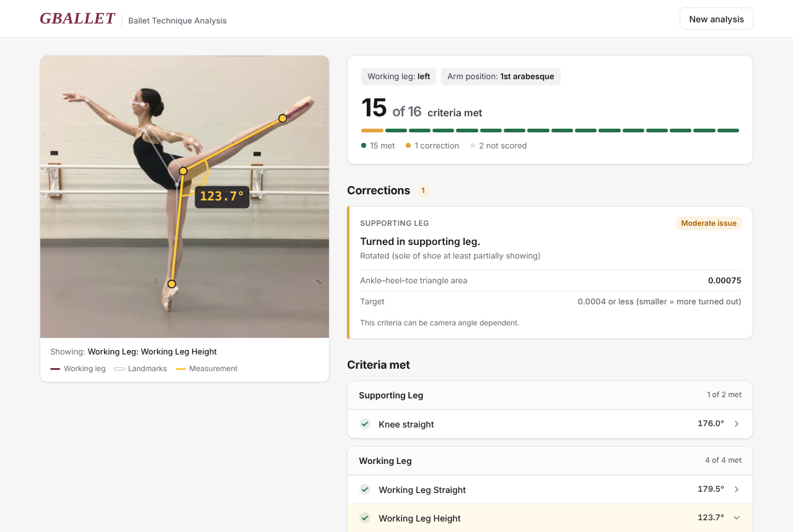

# GBALLET: Ballet Technique Analysis

**G**eometry-**B**ased **A**nalysis of **L**andmarks & **L**ines for **E**nhancing **T**echnique

Upload a photo of a ballet arabesque and receive feedback across 16 classical ballet technique criteria.

**Live demo:** https://avaallwardt.github.io/gballet/



## What GBALLET does

1. Verifies the photo is a ballet arabesque (possible error inputs: dancer not detected, leg not lifted, leg in front, attitude, photo upside down)
2. Translates geometric measurements into 16 interpretable criteria that measure technique of the supporting leg, working leg, hips, chest and back, head, and arms
3. Lists unsatisfied criteria in the form of corrections for the dancer, then displays satisfied criteria grouped by technique category
4. Displays the measurement that informs each criterion score, and draws the measurement on the photo

MediaPipe identifies the body landmarks, then a geometric framework I developed assesses ballet technique from the landmarks. There is no trained classifier.

## How it works

```
photo → landmarks → interpretable features → criteria scores → feedback
```

| Step | What happens | Code |
|---|---|---|
| 1. Extract landmarks | MediaPipe Pose Landmarker finds 33 body points | `analysis/landmarks.py` |
| 2. Compute the geometry | landmarks become angles, lines, and distances | `analysis/features.py`, `analysis/geometry.py` |
| 3. Criteria scores | each feature is checked against a threshold: good / moderate issue / major issue | `analysis/criteria.py` |
| 4. Feedback | each score maps to a correction, plus the measurement and target | `analysis/feedback.py`, `analysis/explain.py` |

### The geometric framework

- **Joint angles** use the angle between two vectors at a joint, `cos θ = (u · v) / (|u||v|)` (knee, foot, elbow, wrist, leg height).
- **Which way a knee bends.** `arccos` only gives an unsigned angle in [0°, 180°], so a bent knee and a hyperextended knee can have the same angle. The sign of the 2D cross product tells them apart, relative to the direction the dancer faces.
- **Facing direction** comes from the arabesque itself: the working leg extends behind the body, so the dancer faces away from the working foot. This keeps the cross-product rules correct even when MediaPipe swaps left and right on side views.
- **Aspect-corrected coordinates.** MediaPipe divides x by image width and y by image height. On a non-square photo that skews angles (one test photo measured 81° raw vs. 105° corrected), so x is rescaled by width / height.
- **Scale-free distances.** Hip and shoulder separation are divided by torso length, and heel offset by foot length, so the size of the dancer in the frame doesn't matter.
- **Supporting leg turnout:** with more rotation, the heel moves behind the ankle in 2D, so the ankle–heel–toe triangle (shoelace formula) collapses.
- **Working leg turnout:** the perpendicular distance from the heel to the ankle–toe line. A visible heel means the leg is underrotated or overrotated.

### Criteria

| Body area | Criteria | Measurement | Target |
|---|---|---|---|
| Supporting leg | Rotated | ankle–heel–toe triangle area | ≤ 0.0004 |
| | Knee straight | hip–knee–ankle angle + bend direction | ≥ 177°, hyperextension ok to 170° |
| Working leg | Straight | hip–knee–ankle angle + bend direction | ≥ 175° |
| | Height | supporting ankle–hip–working ankle | > 90° |
| | Foot (wing) | knee–ankle–toe angle | 165°–180° |
| | Rotated | heel distance from ankle–toe line | ≤ 0.10 × foot length |
| Hips | Square | hip separation | ≤ 0.30 × torso length |
| Chest & back | Lifted and supported | torso tilt from vertical | ≤ 45° |
| | Sternum to head vertical | sternum → center of head, from vertical | within 15° |
| | Back square | shoulder separation | ≤ 0.25 × torso length |
| Head | Looking slightly upward over the finger | center of head → nose, above level | 5°–35°, at or above the fingertip |
| Front arm (1st arabesque) | Height | shoulder → top of hand, above horizontal | 25°–30° |
| | Break in wrist | elbow–wrist–fingers angle | 140°–170° |
| | Slight break in elbow | shoulder–elbow–wrist angle | 155°–175° |
| Side arm | Below shoulder | wrist vs. shoulder height | wrist below shoulder |
| | Straight | shoulder–elbow–wrist angle | ≥ 165° |

Fingers soft is listed but not yet scored due to the lack of granularity in finger landmark detection.

## Architecture

The website is fully static (GitHub Pages), and the same Python code runs in the browser and from the command line:

- **Website:** MediaPipe's JavaScript build finds the landmarks in the browser, then the Python package in `analysis/` runs unchanged in [Pyodide](https://pyodide.org) (Python compiled to WebAssembly). Photos never leave the visitor's device, and there's no server to keep running.
- **Command line and tests:** MediaPipe's Python build finds the landmarks, then the same `analysis/` package runs.

The JavaScript and Python builds of MediaPipe can place a joint slightly differently on difficult photos. On my test photos the website and command line agreed on 10 of 12, and the other two differed by one borderline criteria each.

## Run it locally

Website:
```
python3 -m http.server 8000
```
Then open http://localhost:8000

Command line (prints every criteria, score, measurement and target):
```
python3 -m venv .venv
source .venv/bin/activate
python3 -m pip install -r requirements.txt
python3 cli.py samples/example-arabesque.jpg
```

Tests:
```
python3 -m pytest
```

## Project structure

```
index.html, web/         the website (UI, photo overlay, in-browser engine)
analysis/
  landmarks.py           step 1: MediaPipe landmarks
  geometry.py            angle_at, cross, triangle_area, dist, perp_dist
  features.py            step 2: interpretable features
  criteria.py            step 3: criteria scores (all thresholds in one dict, T)
  feedback.py            step 4: all feedback wording
  explain.py             measurement + target for each criteria, and what to draw
  pipeline.py            connects the steps
cli.py                   command line version
tests/                   geometry unit tests + end-to-end test on the example photo
exploration/             my original exploration script and technique rules
pose_landmarker_full.task  MediaPipe pose model
```

## Limitations and next steps

- A single 2D photo can't fully capture 3D rotation, so turnout criteria depend on camera angle.
- Supporting leg turnout uses raw ankle-heel-toe triangle area, which depends on how large the dancer is in the frame.
- Several thresholds are subjective based on my classical ballet training. Other ballet styles, such as Balanchine, may define other criteria for an optimal arabesque.
- Arm criteria are written for 1st arabesque only.
- Image analysis is only suitable for static poses, including arabesque. Analyzing ballet movement would require video analysis.

## Citation
- Independently designed the criteria for analyzing an arabesque.
- Independently developed the code for extracting landmarks, computing measurements, and mapping measurements to interpretable ballet technique corrections.
- All technique analysis is based on my own ballet training.
- Used Claude to create frontend and setup the live demo.
